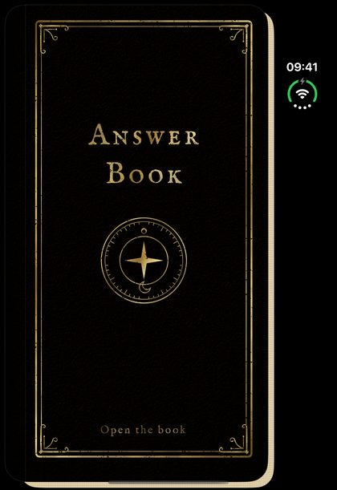
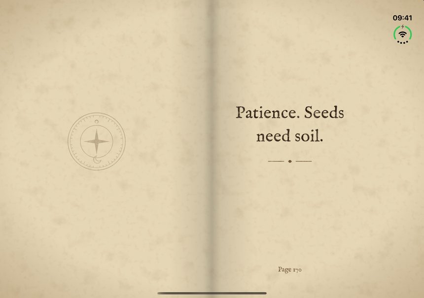

# Answer Book

English | [简体中文](README.zh-CN.md)

**Close your phone and it is a book. Open it and you land on a random page with an answer.**

Answer Book is a small open-source iOS app made for the iPhone Duo, dressed as an old black leather book with gold foil and aged paper. Think of a question, open the phone like a book, and read the page you landed on. Flick the phone half shut and open it again to turn the page. Close it to start over.

On iPhones and iPads without a hinge, tap the cover to open the book, tap a page to turn it, and swipe down to close it.

It also comes to Apple Watch: turn the Digital Crown to riffle through the pages and stop on your answer.

## Screenshots

<p align="center">
  
  &nbsp;
  
</p>

Closed, the outer display shows the cover. Open the phone and the inner display shows the book as a two-page spread. Taken in the iPhone Duo simulator.

## How it uses the hinge

The app is built on [HingeKit](https://github.com/MIDJUG3Nine/HingeKit), which turns the iOS 27.1 hinge API into simple events:

| What you do | HingeKit event | What the book does |
| --- | --- | --- |
| Open the phone | `.opened` | Opens on a random page |
| Flick it half shut and back | `.pageTurn` | Turns to another page |
| Close the phone | `.closed` | Shows the cover again |

See `AnswerBook/Views/BookView.swift`; the whole hinge logic is about ten lines.

## On Apple Watch

The watch app ships inside the iPhone app and can also be installed on its own, without the iPhone app. It needs watchOS 10 or later.

| What you do | What the book does |
| --- | --- |
| Turn the Digital Crown | Riffles through the pages, one click under your finger for each page |
| Stop turning | Falls open on the page you stopped at |
| Tap, or double tap (Series 9, Ultra 2 and later) | Opens the book, or turns to another page |
| Lower your wrist | The answer stays in pale ink on the Always On screen |

The answers, the deck, the fonts, textures and strings are shared with the iPhone app; the watch's own views are in `AnswerBookWatch/`.

## Features

- A black leather-bound book: gold-foil cover with corner ornaments and an emblem, answers printed on aged paper. On the iPhone Duo's inner display the open book shows as a two-page spread.
- The type sits in the book, not on top of it. Answers are set in Noto Serif SC and IM FELL English (a revival of 17th-century English type) and soak into the paper like ink; the title is gold foil stamped into the leather.
- Each time you open the app, the book shows its name and asks you to think of a question before it opens.
- 365 original answers, one for every day of the year, in English and Simplified Chinese, shown in the reader's language.
- Answers are dealt like shuffled cards: no repeats until every page has been read, never the same page twice in a row.
- VoiceOver labels, Dynamic Type and Reduce Motion are supported. The book looks the same in light and dark mode, like a real object.
- No account, no network, no tracking. Nothing leaves the phone.

## Build

1. Install [XcodeGen](https://github.com/yonaskolb/XcodeGen) and Xcode 27.1 or later.
2. Run `xcodegen generate` and open `AnswerBook.xcodeproj`. Xcode fetches [HingeKit](https://github.com/MIDJUG3Nine/HingeKit) from GitHub with Swift Package Manager.
3. Set your own team under Signing & Capabilities.

The Run scheme sets `HINGE_SIMULATOR=1`, which shows HingeKit's hinge simulator panel in Debug builds so you can try the fold gestures on any simulator.

## Artwork

The leather, paper, corner ornament, emblem and app icon are drawn in SVG. The sources are in [`design/`](design/), with notes on how to render them into `Assets.xcassets`, along with the scripts that draw the ink and foil masks and cut the Chinese font down to the characters the book uses.

## Tests

```sh
xcodebuild test -scheme AnswerBook -destination 'platform=iOS Simulator,name=iPhone 17'
xcodebuild test -scheme AnswerBookWatch -destination 'platform=watchOS Simulator,name=Apple Watch Series 11 (46mm)'
```

## Star History

<a href="https://www.star-history.com/#MIDJUG3Nine/AnswerBook_iDUO&Date">
  <picture>
    <source media="(prefers-color-scheme: dark)" srcset="https://api.star-history.com/svg?repos=midjug3nine%2fanswerbook_iduo&type=Date&theme=dark" />
    <source media="(prefers-color-scheme: light)" srcset="https://api.star-history.com/svg?repos=midjug3nine%2fanswerbook_iduo&type=Date" />
    
  </picture>
</a>

## License

The code and the answer texts are released under the MIT License.

The fonts in `AnswerBook/Resources/Fonts` (Noto Serif SC, cut down to the characters the book uses, and IM FELL English) are under the SIL Open Font License 1.1; their license files are next to them.

The Answer Book name and app icon are not covered by the license. If you publish your own build, please use your own name and icon.

The answers are written for this project and are not taken from any book. This project is not affiliated with Apple. iPhone is a trademark of Apple Inc.
